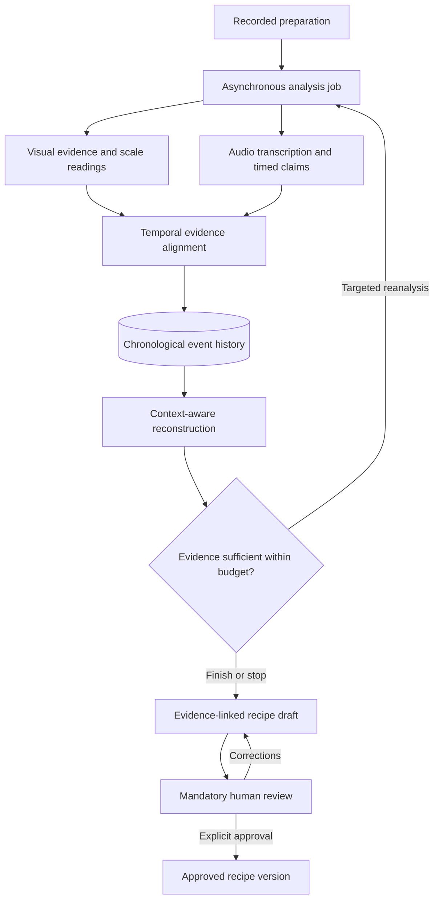
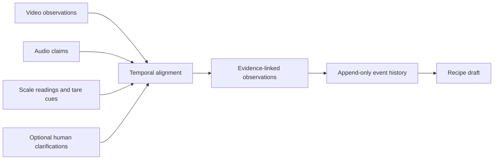

# Bakery Intelligence — System Proposal

**Status:** Proposed architecture · **Domain:** Bakery and pastry production

## Problem and value proposition

Kitchen procedures are often demonstrated rather than formally documented. Important details may be scattered across actions, digital-scale readings, ingredient packaging, and spoken explanations. Writing a usable recipe from a recording requires sustained human attention and can be error-prone.

**Bakery Intelligence** aims to turn recorded preparations into **evidence-linked recipe drafts**. A qualified person must review, correct, and explicitly approve every draft before operational use. The intended benefit is to shift staff effort from writing documentation to verifying it. Time savings, lower costs, and reduced mental workload are hypotheses, not demonstrated outcomes.

## Proposed system

The system processes recorded videos **asynchronously**, not in real time. It extracts timestamped evidence, reconstructs a chronological sequence of actions, and generates a reviewable draft. Audio is an intended input for the final multimodal validation, including spoken ingredient names and quantities. A narrated quantity is a **claim**, not a verified measurement.

The first implementation can be a modular application with a single processing worker. Job queues, distributed workers, and multi-tenant SaaS capabilities are potential future deployment options, **not current implementation claims**.

## Time-indexed evidence and event memory

Observations from different sources are recorded independently and aligned by time **and meaning**. A spoken instruction may describe an earlier or later action; overlapping timestamps alone do not prove correspondence.

The event history records ingredient additions, tare operations, mixing, removals, and unresolved actions **in order**. Ingredient totals are derived from reconciled events, never by indiscriminately summing scale displays. A zero reading after tare does not mean the container is empty. Observations, model inferences, and human confirmations retain separate provenance.

Optional human-in-the-loop (HITL) clarification may resolve ambiguous objects during processing. Prior human identifications can be reused **only within the same video**, when evidence supports that they refer to the same object. HITL does not replace mandatory final approval.

## Research hypotheses

- **H1 — Temporal context:** structured event memory improves reconstruction compared with isolated visual observations.
- **H2 — Audio contribution:** aligned narration improves ingredient and quantity interpretation without unacceptable false associations.
- **H3 — Cost-aware analysis:** targeted additional analysis improves the quality–cost tradeoff compared with indiscriminate repeated processing.
- **H4 — Human productivity:** reviewing an evidence-linked draft requires less active human effort and lower total cost than manual documentation at comparable quality.

## Validation and business case

The intended evaluation compares three configurations on **at least ten independent holdout videos**: (A) visual baseline, (B) visual plus event memory, and (C) visual plus memory plus audio. The final multimodal configuration is the **target**; if audio is not implemented and tested, the multimodal objective must be reported as incomplete rather than silently redefined. Human clarification during inference is excluded from autonomous scores.

Evaluation considers sequence correctness, ingredient and quantity accuracy, tare detection, uncertainty, evidence traceability, processing cost, and time. A separate, comparable manual-documentation study is required to establish human time savings.

The commercial hypothesis is that **AI processing + infrastructure + human review and corrections** costs less than equivalent-quality manual documentation. Low API expenditure alone does not prove viability.

## Evidence and limitations

**Previously reported project results:** Meta API connectivity; 10/10 exact readings on controlled synthetic scale images across two runs; timestamped frame extraction from a real cooking video; preliminary manual observations; and eight passing frame-extraction tests. These are limited observations, **not** evidence of end-to-end recipe accuracy. See the versioned experiment records for reproducibility; this document does not claim those experiments were rerun.

**Not yet demonstrated:** complete autonomous reconstruction, reliable audio alignment, real-world accuracy, economic savings, operational HITL, and SaaS readiness. Ambiguous ingredients, occluded displays, tare history, misleading narration, and incomplete footage remain substantive risks.

**Product principle:** *The system prepares the documentation; a human remains responsible for approving it.*
